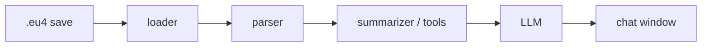

# eu4-chancellor

> AI assistant for Europa Universalis IV that reads your save files and answers questions
> with the real context of your campaign.


## The problem

Europa Universalis IV is famously deep. Asking an LLM for advice mid-campaign works well,
but the game state changes constantly, so every question needs a fresh, hand-written
description of your situation: treasury, armies, wars, allies, rivals, neighbours...

## The idea

The game already writes the full state of your campaign to disk every time it saves.
**eu4-chancellor** watches your save folder, parses the latest save, and gives an LLM
exactly the context it needs to answer your question — no copy-pasting required.



## Roadmap at a glance

| Phase | Deliverable | Status |
| --- | --- | --- |
| 0 | Understand and document the save format | Mostly done |
| 1 | CLI that copies a campaign summary to the clipboard | Working MVP |
| 2 | Query tools: any country's briefing, war feasibility, world overview | In progress |
| 3 | Game knowledge: missions, decisions and events crossed with the campaign | Planned |
| 4 | Chat workspace docked beside the game, with an agent that uses the tools | Planned |
| 5 | Charts and trends across your saves | Planned |
| 6 | Experimental: Claude acts in-game through computer use | Idea |

See [docs/VISION.md](docs/VISION.md) for the goals and [docs/ROADMAP.md](docs/ROADMAP.md)
for the detailed task list.

## Installation (development)

Requires Python 3.11+.

```bash
git clone https://github.com/aitzolmor/eu4-chancellor.git
cd eu4-chancellor
python -m venv .venv
.venv\Scripts\activate          # Windows
# source .venv/bin/activate     # macOS / Linux
pip install -e ".[dev]"
cp .env.example .env            # then fill in your values
```

## Usage

```bash
chancellor summary              # print a briefing of your current campaign
chancellor summary --copy       # ...and copy it to the clipboard, ready to paste into a chat
chancellor summary --save "path/to/save.eu4" --output briefing.md
chancellor country Borgoña      # the same briefing for any country, plus its relation to you
chancellor country BUR --copy   # tags work too; names are accent- and case-insensitive
```

The briefing is a compact Markdown document (about 1k tokens) covering ruler, stability,
economy, military, territory, technology and ideas, estates, diplomacy, ongoing wars and
a table of key countries, with names in your game's language. Briefings of other countries
add how they relate to you (alliances, rivalries, wars, borders, opinions) and a side-by-side
strength comparison.

```text
# Campaign briefing: Castilla (CAS), 1525.6.30

## Economy
- Treasury: 187.3 ducats
- Last month balance: +121.5 ducats
- Loans: 4 totalling 572.0 ducats
...
| Country | Relation | Development | Regiments | Mil tech | Their opinion of us |
| Francia (FRA) | our rival, rivals us, neighbour | 714 | 64 | 10 | -46 (Rivalidad) |
```

Coming next: queries about any country and possible wars (Phase 2), then game knowledge
and a chat window docked beside the game.

## Limitations

- **Ironman saves** are binary and need a token file that is not publicly distributed.
  Only non-ironman (plain text) saves are supported for now.
- EU4 mods cannot make network requests, so the chat lives in a separate window rather
  than inside the game UI.

## Documentation

- [Vision](docs/VISION.md)
- [Architecture](docs/ARCHITECTURE.md)
- [Save format notes](docs/SAVE_FORMAT.md)
- [Design decisions](docs/DECISIONS.md)

## Acknowledgements

- [PDX Tools](https://pdx.tools) and the [`eu4save`](https://github.com/rakaly/eu4save)
  crate, which showed what is possible with EU4 saves.

## License

[MIT](LICENSE). Europa Universalis IV is a trademark of Paradox Interactive. This project
is not affiliated with or endorsed by Paradox Interactive.
