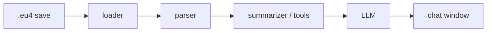

# eu4-chancellor

> AI assistant for Europa Universalis IV that reads your save files and answers questions
> with the real context of your campaign.


## The problem

Europa Universalis IV is famously deep. Asking an LLM for advice mid-campaign works well,
but the game state changes constantly, so every question needs a fresh, hand-written
description of your situation: treasury, armies, wars, allies, rivals, neighbours...

## The idea

The game already writes the full state of your campaign to disk every time it saves.
**eu4-chancellor** watches your save folder, parses the latest save, and gives an LLM
exactly the context it needs to answer your question — no copy-pasting required.



## Roadmap at a glance

| Phase | Deliverable | Status |
| --- | --- | --- |
| 0 | Understand and document the save format | In progress |
| 1 | CLI that copies a campaign summary to the clipboard | Planned |
| 2 | Always-on-top chat window that auto-attaches the summary | Planned |
| 3 | Tool-using agent that can query any country, province or war | Planned |

See [docs/ROADMAP.md](docs/ROADMAP.md) for the detailed task list.

## Installation (development)

Requires Python 3.11+.

```bash
git clone https://github.com/aitzolmor/eu4-chancellor.git
cd eu4-chancellor
python -m venv .venv
.venv\Scripts\activate          # Windows
# source .venv/bin/activate     # macOS / Linux
pip install -e ".[dev]"
cp .env.example .env            # then fill in your values
```

## Planned usage

```bash
chancellor summary              # Phase 1: summarize the latest save to the clipboard
chancellor chat                 # Phase 2: open the chat window
```

## Limitations

- **Ironman saves** are binary and need a token file that is not publicly distributed.
  Only non-ironman (plain text) saves are supported for now.
- EU4 mods cannot make network requests, so the chat lives in a separate window rather
  than inside the game UI.

## Documentation

- [Architecture](docs/ARCHITECTURE.md)
- [Save format notes](docs/SAVE_FORMAT.md)
- [Design decisions](docs/DECISIONS.md)

## Acknowledgements

- [PDX Tools](https://pdx.tools) and the [`eu4save`](https://github.com/rakaly/eu4save)
  crate, which showed what is possible with EU4 saves.

## License

[MIT](LICENSE). Europa Universalis IV is a trademark of Paradox Interactive. This project
is not affiliated with or endorsed by Paradox Interactive.
