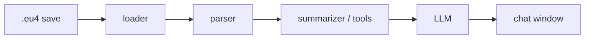

# eu4-chancellor

> AI assistant for Europa Universalis IV that reads your save files and answers questions
> with the real context of your campaign.


## The problem

Europa Universalis IV is famously deep. Asking an LLM for advice mid-campaign works well,
but the game state changes constantly, so every question needs a fresh, hand-written
description of your situation: treasury, armies, wars, allies, rivals, neighbours...

## The idea

The game already writes the full state of your campaign to disk every time it saves.
**eu4-chancellor** watches your save folder, parses the latest save, and gives an LLM
exactly the context it needs to answer your question — no copy-pasting required.



## Roadmap at a glance

| Phase | Deliverable | Status |
| --- | --- | --- |
| 0 | Understand and document the save format | Mostly done |
| 1 | CLI that copies a campaign summary to the clipboard | Working MVP |
| 2 | Query tools: any country's briefing, war feasibility, world overview | Working |
| 3 | Game knowledge: missions, decisions and events crossed with the campaign | Working |
| 4 | Chat workspace docked beside the game, with an agent that uses the tools | Terminal chat working |
| 5 | Charts and trends across your saves | Planned |
| 6 | Experimental: Claude acts in-game through computer use | Idea |

See [docs/VISION.md](docs/VISION.md) for the goals and [docs/ROADMAP.md](docs/ROADMAP.md)
for the detailed task list.

## Installation (development)

Requires Python 3.11+.

```bash
git clone https://github.com/aitzolmor/eu4-chancellor.git
cd eu4-chancellor
python -m venv .venv
.venv\Scripts\activate          # Windows
# source .venv/bin/activate     # macOS / Linux
pip install -e ".[dev]"
cp .env.example .env            # then fill in your values
```

## Usage

```bash
chancellor summary              # print a briefing of your current campaign
chancellor summary --copy       # ...and copy it to the clipboard, ready to paste into a chat
chancellor summary --save "path/to/save.eu4" --output briefing.md
chancellor country Borgoña      # the same briefing for any country, plus its relation to you
chancellor country BUR --copy   # tags work too; names are accent- and case-insensitive
chancellor war-check Venecia    # who would defend the target and who would join you
chancellor world                # great powers, rankings, alliance networks and major wars
chancellor missions             # your mission tree: done, available now, locked, with rewards
chancellor missions Francia --brief
chancellor decisions --formables # nations you can form and what you are missing
chancellor targets              # where to expand next, and how hard each target is
```

The briefing is a compact Markdown document (about 1k tokens) covering ruler, stability,
economy, military, territory, technology and ideas, estates, diplomacy, ongoing wars and
a table of key countries, with names in your game's language. Briefings of other countries
add how they relate to you (alliances, rivalries, wars, borders, opinions) and a side-by-side
strength comparison.

`war-check` lists every country that would fight if you declared war today: the target's
allies, subjects, overlord, guarantors, the Holy Roman Emperor and any coalition against you,
plus your own allies and subjects. Each one is marked certain, likely or possible, and the
totals show the regiments and manpower on each side.

`world` gives the big picture that long-term plans depend on: the great powers, the largest
countries by development and army, each major power's alliance network, the biggest
ongoing wars, personal unions and the Holy Roman Empire.

`missions` reads the mission trees from your game installation and marks each mission as
completed, available now or locked. Available missions show their requirements, and every
open mission shows its rewards, translated from game script into readable lines with
localised province, area and country names. Granted modifiers list their actual bonuses,
e.g. *La corona de hierro de Lombardía (permanent): Mejorar relaciones +15%, Tiempo de
viaje -20%*.

`decisions` lists the formable nations and decisions a country can see, each with a
checklist: requirements met `[x]`, not met `[ ]` and not checkable automatically `[?]`.
For example, Austria in 1475 sees *Austria-Hungary* with 13 of 15 requirements met:
Hungary has over 40 cities and the administrative technology is too low.

`targets` ties it all together. It gathers the provinces your available missions,
formable nations, claims and cores point at, groups them by who holds them now, and runs a
war check against each owner. Favourable targets come first. Targets protected by
coalitions or strong alliances are listed apart, and so are provinces held by your own
subjects or allies (diplomacy, not war).

```text
# Campaign briefing: Castilla (CAS), 1525.6.30

## Economy
- Treasury: 187.3 ducats
- Last month balance: +121.5 ducats
- Loans: 4 totalling 572.0 ducats
...
| Country | Relation | Development | Regiments | Mil tech | Their opinion of us |
| Francia (FRA) | our rival, rivals us, neighbour | 714 | 64 | 10 | -46 (Rivalidad) |
```

Coming next: a desktop window docked beside the game for the chat (Phase 4), then charts of
your campaign across saves (Phase 5).

Game data (localisation, missions, decisions…) is parsed once and cached in your user
cache folder. It is rebuilt automatically after a game patch; `chancellor clear-cache`
removes it.

## Chat

```bash
chancellor chat
```

Ask in plain language, in any language: *"¿Me sale rentable atacar a Borgoña?"*, *"What
should Austria aim for in the next 50 years?"*. The Chancellor (Claude Opus 5.5) decides
which queries to run (country briefings, war checks, the world overview, missions,
formable nations, expansion targets), reads the results, and answers with the numbers
behind its advice. When you save the game, the next question uses the new save.

It needs an Anthropic API key in `.env` (`ANTHROPIC_API_KEY`, see `.env.example`). Each
question is billed by the API: a few tool lookups plus the answer usually cost a few cents.
`/usage` shows the tokens used in the session.

## Use it from Claude Desktop (no API key needed)

If you have a Claude subscription, Claude Desktop can use the Chancellor's tools directly
through MCP. You chat in Claude Desktop as usual, and questions about your campaign are
answered from your save, at no extra cost beyond your plan.

1. Print the configuration for your machine:

   ```bash
   chancellor mcp-config
   ```

2. In Claude Desktop, open **Settings → Developer → Edit Config** and merge the printed
   `mcpServers` entry into `claude_desktop_config.json`.
3. Restart Claude Desktop. The `eu4-chancellor` tools appear in the tools menu; ask
   something like *"¿Cómo va mi partida?"*.

Every tool call reads the newest save, so just save the game before asking.

## Desktop panel (early preview)

A small window to keep beside the game, with your campaign at a glance: country, date,
save, what needs attention (coalitions, truces ending, debt, a reform ready...),
treasury, manpower, stability, monarch power and wars. It refreshes by itself when you
save. Chat with the Chancellor in Claude Desktop next to it; the panel reads the
same save.

```bash
pip install -e ".[ui]"
chancellor app
```

With two screens, **Dock beside the game** puts the panel and Claude Desktop on the
screen the game is not on, and **Undock** puts them back. With one screen, a small crown
icon floats over the game instead: drag it wherever it is out of the way, click it to
open the panel and Claude Desktop over that side of the screen, and click again (or press
`Esc`) to get back to the game. Run EU4 in borderless windowed mode. Charts are on the
way; see [docs/UI_DESIGN.md](docs/UI_DESIGN.md).

## Limitations

- **Ironman saves** are binary and need a token file that is not publicly distributed.
  Only non-ironman (plain text) saves are supported for now.
- EU4 mods cannot make network requests, so the chat lives in a separate window rather
  than inside the game UI.

## Documentation

- [Vision](docs/VISION.md)
- [Architecture](docs/ARCHITECTURE.md)
- [Save format notes](docs/SAVE_FORMAT.md)
- [Design decisions](docs/DECISIONS.md)

## Acknowledgements

- [PDX Tools](https://pdx.tools) and the [`eu4save`](https://github.com/rakaly/eu4save)
  crate, which showed what is possible with EU4 saves.

## License

[MIT](LICENSE). Europa Universalis IV is a trademark of Paradox Interactive. This project
is not affiliated with or endorsed by Paradox Interactive.
