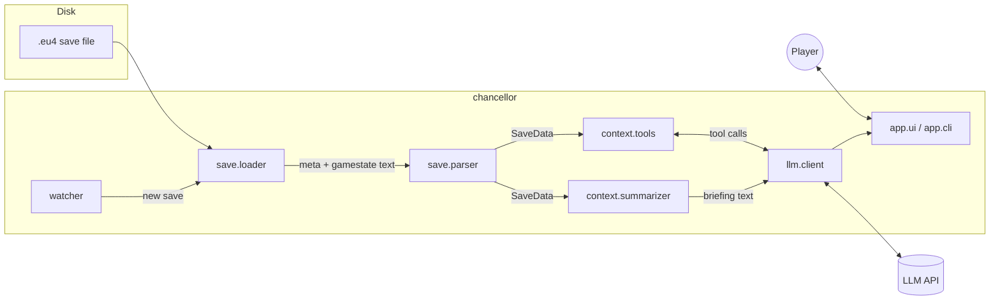

# Architecture

## Data flow

## Modules

| Module | Responsibility | Phase |
| --- | --- | --- |
| `config` | Load settings from environment / `.env` | 1 |
| `save.loader` | Locate the newest save; open zip or raw text; detect ironman | 1 |
| `save.parser` | Turn Clausewitz text into nested Python data; `parse_lazy` defers nested blocks so only what is needed gets parsed | 1 |
| `game.localisation` | Readable names from the game's localisation files; detects the player's language | 1 |
| `context.summarizer` | Build a compact, LLM-friendly Markdown briefing of the player's situation | 1 |
| `app.cli` | Command-line entry point (`chancellor`) | 1 |
| `app.clipboard` | Dependency-free clipboard copy (Win32 API, `pbcopy`, `wl-copy`/`xclip`) | 1 |
| `llm.client` | Talk to the LLM API: streaming, caching, tool-use loop | 2–3 |
| `watcher` | Watch the save folder and trigger reloads | 2 |
| `app.ui` | Always-on-top chat window | 2 |
| `context.tools` | Query functions exposed to the model as tools | 3 |

Planned later (not yet scaffolded): a window-layout module that docks EU4 beside the app
(Phase 2), a charts/history module (Phase 4), and a computer-use actor (Phase 5).
See [VISION.md](VISION.md).

## Design principles

- **Layers only depend downward.** `save` knows nothing about LLMs; `context` knows nothing
  about the UI. This keeps the parser testable and reusable.
- **Context is a budget.** A gamestate is tens of MB (millions of tokens). Every layer above
  the parser exists to select and compress — never forward raw gamestate to the model.
- **Pure functions where possible.** Parsing and summarising take data in and return data
  out, which makes fixture-based tests straightforward.
