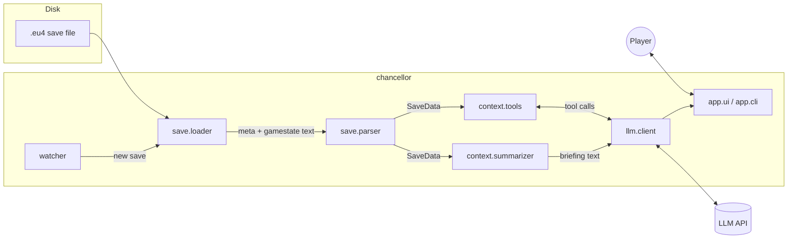

# Architecture

## Data flow

## Modules

| Module | Responsibility | Phase |
| --- | --- | --- |
| `config` | Load settings from environment / `.env` | 1 |
| `save.loader` | Locate the newest save; open zip or raw text; detect ironman | 1 |
| `save.parser` | Turn Clausewitz text into nested Python data; `parse_lazy` defers nested blocks so only what is needed gets parsed | 1 |
| `game.localisation` | Readable names from the game's localisation files; detects the player's language | 1 |
| `context.campaign` | Shared, cached view of one loaded save: countries, wars, names, country lookup by name | 2 |
| `context.summarizer` | Build a compact, LLM-friendly Markdown briefing from any country's perspective | 1–2 |
| `app.cli` | Command-line entry point (`chancellor`) | 1 |
| `app.clipboard` | Dependency-free clipboard copy (Win32 API, `pbcopy`, `wl-copy`/`xclip`) | 1 |
| `context.war_check` | Who would fight in a hypothetical war and how strong each side is (`WarCheck` dataclass + Markdown renderer) | 2 |
| `context.world` | World overview: great powers, rankings, alliance networks, wars, unions, HRE (`WorldOverview` dataclass + renderer) | 2 |
| `game.missions` | Mission series from the game's `missions/` folder (`MissionLibrary`) | 3 |
| `game.modifiers` | Named modifiers and the stats they change (`ModifierLibrary`, `format_effect`) | 3 |
| `game.imperial_reforms` | HRE imperial reforms: order, branches, DLC set, modifiers; the next reform (`ImperialReformLibrary`) | 4 |
| `context.script` | Readable, localised descriptions of trigger and effect script | 3 |
| `context.missions` | A country's mission tree with completed / available / locked status | 3 |
| `game.cache` | On-disk cache of parsed game data, invalidated by file size/mtime and package version | 3 |
| `game.rules` | Culture/religion groups, geography (areas, regions, colonial regions…), scripted triggers | 3 |
| `game.decisions` | Decisions and formable nations from `decisions/` (`DecisionLibrary`) | 3 |
| `context.conditions` | Three-valued evaluator for game conditions (true / false / unknown) | 3 |
| `context.decisions` | Decisions a country can see, with a requirement checklist | 3 |
| `context.targets` | Expansion targets: wanted provinces by owner, with war odds (`TargetReport`) | 3 |
| `context.tools` | The queries as agent tools: definitions, input validation, `Toolbox` bound to a save | 4 |
| `llm.client` | `ChancellorAgent`: streaming tool-use loop on the Messages API (caching, thinking, fallbacks) | 4 |
| `app.chat` | Terminal chat: follows the newest save, prints streamed answers and tool calls | 4 |
| `app.mcp_server` | MCP server for Claude Desktop: the same tools over stdio, reloading the newest save | 4 |
| `watcher` | Watch the save folder and trigger reloads | 4 |
| `app.ui` | Chat window docked beside the game | 4 |

Every query follows the same pattern (D-009): a function takes a `Campaign` and returns
structured data, the CLI renders it as Markdown, and the agent receives it as a tool
result.

Planned later (not yet scaffolded): a window-layout module that docks EU4 beside the app
(Phase 4), a game-knowledge module for missions/events (Phase 3), a charts/history module
(Phase 5), and a computer-use actor (Phase 6).
See [VISION.md](VISION.md).

## Design principles

- **Layers only depend downward.** `save` knows nothing about LLMs; `context` knows nothing
  about the UI. This keeps the parser testable and reusable.
- **Context is a budget.** A gamestate is tens of MB (millions of tokens). Every layer above
  the parser exists to select and compress — never forward raw gamestate to the model.
- **Pure functions where possible.** Parsing and summarising take data in and return data
  out, which makes fixture-based tests straightforward.
